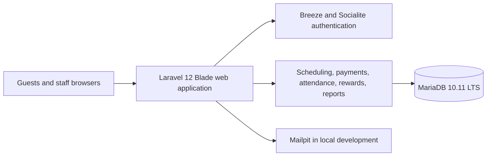

# Casa Paraiso Docs Home

Index of the project documentation. Links are relative Markdown links so they work in Obsidian and on GitHub.

## Core

- [MVP Scope](MVP_SCOPE.md)
- [Tech Stack](TECH_STACK.md)
- [Project Memory](PROJECT_MEMORY.md)

## Data

- [Database Design](DATABASE_DESIGN.md)
- [MariaDB Migration](MARIADB_MIGRATION.md)

## UI

- [Screen Flow](SCREEN_FLOW.md)
- [Brand UI Guide](BRAND_UI_GUIDE.md)
- [Modern Resort Redesign](REDESIGN_MODERN_RESORT.md) (the live `redesign` release)

## Operations and Deployment

- [Docker Workflow](DOCKER_WORKFLOW.md)
- [Hostinger Deployment](HOSTINGER_DEPLOYMENT.md)
- [Security Hardening](SECURITY_HARDENING.md)
- [Google Auth Setup](GOOGLE_AUTH_SETUP.md)
- [Local Demo Credentials](LOCAL_DEMO_CREDENTIALS.md) (local development only)

## Sentiment Analysis

- [Sentiment Analysis Implementation Plan](SENTIMENT_ANALYSIS_IMPLEMENTATION_PLAN.md)
- [Sentiment Data Governance](SENTIMENT_DATA_GOVERNANCE.md)
- [Sentiment Dataset Manifest](sentiment-dataset-manifest.json)

## Session Notes

- [Session Index](notes/SESSIONS.md): per-task logs, newest first. Read the latest entries before starting a task.

## Archive (historical)

Finished or retired documents, kept for reference only. Current guidance lives in the sections above.

- [Implementation Roadmap](archive/IMPLEMENTATION_ROADMAP.md): the pre-Hostinger delivery plan, now complete.
- [Tasks To Do](archive/TASKS_TO_DO.md): the receptionist, booking and commission tasks, all done.
- [CRUD Data Repair Plan](archive/CRUD_DATA_REPAIR_PLAN.md) and [CRUD Remediation Checklist](archive/CRUD_REMEDIATION_CHECKLIST.md): the July 2026 audit.
- [Frontend Consistency Audit](archive/FRONTEND_CONSISTENCY_AUDIT.md): the October 18 audit, acted on by the redesign.
- [Render and Oracle Deployment](archive/RENDER_ORACLE_DEPLOYMENT.md): the retired hosting before Hostinger.

## Architecture

Source: [system-architecture.mmd](system-architecture.mmd)

