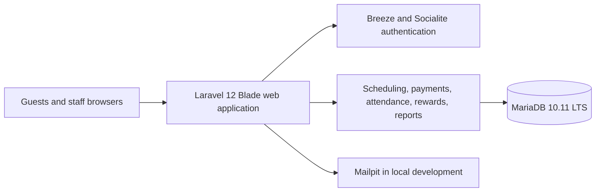

# Casa Paraiso Docs Home

Index of the project documentation. Links are relative Markdown links so they work in Obsidian and on GitHub.

## Core

- [MVP Scope](MVP_SCOPE.md)
- [Tech Stack](TECH_STACK.md)
- [Project Memory](PROJECT_MEMORY.md)
- [Planned Tasks](PLANNED_TASKS.md) (recorded, not started)
- [Customer Booking Safeguards Design](superpowers/specs/2026-11-01-booking-safeguards-design.md) (T5, implemented)
- [Customer Booking Safeguards Plan](superpowers/plans/2026-11-01-booking-safeguards.md) (T5)
- [Live Updates Design](superpowers/specs/2026-11-02-live-updates-design.md) (Task 9, implemented)
- [RFM Engine](RFM_ENGINE.md): quintile RFM scoring and the admin-configurable segment rules.
- [Memberships and Gift Vouchers](MEMBERSHIPS_AND_VOUCHERS.md): Gold and Platinum cards, payment pricing, and gift voucher rules.

## Data

- [Database Design](DATABASE_DESIGN.md)
- [MariaDB Migration](MARIADB_MIGRATION.md)

## UI

- [Screen Flow](SCREEN_FLOW.md)
- [Brand UI Guide](BRAND_UI_GUIDE.md)
- [Modern Resort Redesign](REDESIGN_MODERN_RESORT.md) (the live `redesign` release)

## Operations and Deployment

- [Docker Workflow](DOCKER_WORKFLOW.md)
- [Hostinger Deployment](HOSTINGER_DEPLOYMENT.md)
- [Security Hardening](SECURITY_HARDENING.md)
- [Google Auth Setup](GOOGLE_AUTH_SETUP.md)
- [Local Demo Credentials](LOCAL_DEMO_CREDENTIALS.md) (local development only)

## Sentiment Analysis

- [Sentiment Analysis Implementation Plan](SENTIMENT_ANALYSIS_IMPLEMENTATION_PLAN.md)
- [Sentiment Data Governance](SENTIMENT_DATA_GOVERNANCE.md)
- [Sentiment Dataset Manifest](sentiment-dataset-manifest.json)
- [Sentiment Labelling Guide](sentiment/LABELING_GUIDE.md): labels, mixed-comment rules, and the label, agree, lock and evaluate workflow for the curated test set.

## Client Research

Notes about the client kept apart from project scope. They are not requirements until moved into Planned Tasks.

- [Customer Groups and Rewards: Questions for the Client](client/RFM_GROUPS_CLIENT_QUESTIONS.md): a plain-language question sheet for Task 7's open client item (2026-11-01).
- [Facebook Photo Library](client/FACEBOOK_PHOTO_LIBRARY.md): eight selected business images, source links, dimensions, and a visual contact sheet (2026-11-01).
- [Client Facebook Page Review](client/FACEBOOK_PAGE_REVIEW.md): the client's public page checked against the app (2026-11-01).

## Manuscript

- [Temporary Revisions checklist](manuscript/2026-11-02-temporary-revisions-checklist.md): what still needs revising in the tab, including test-label contradictions, NLP figure and table, pending UAT wording, and comment follow-ups; doc unchanged (2026-11-02).
- [Chapter III diagrams](manuscript/2026-11-02-chapter3-diagrams.md): 11 redrawn or new Chapter III figures (architecture, RFM flow, three-part ERD, context, use case, DFD 0/1, booking and sentiment flows), with images, captions, text and renumbering applied in the Doc, Figure 1 redrawn and the three front-matter lists refreshed; [diagram sources](manuscript/diagrams/README.md) (2026-11-02).
- [Chapter-only manuscript revision](manuscript/2026-11-02-chapter-revision-summary.md): delivered Chapter I–V changes, preservation checks and remaining issues (2026-11-02).
- [Manuscript finished-paper comparison](manuscript/2026-11-02-reference-review.md): separate structure, presentation and evidence review against the supplied reference; neither manuscript changed (2026-11-02).

## Session Notes

- [Session Index](notes/SESSIONS.md): per-task logs, newest first. Read the latest entries before starting a task.
- [Chapter III diagrams](notes/sessions/2026-11-02-chapter3-diagrams.md): outdated Figures 4–6 redrawn and six missing diagrams drawn from code; images, text, renumbering, Figure 1 and refreshed lists applied in the Doc (2026-11-02).
- [UAT form formal wording](notes/sessions/2026-11-02-uat-form-formal-wording.md): plain, formal participant wording, §3.6.4 rating scale, participant code removed; form still unpublished (2026-11-02).
- [Chapter-only manuscript revision](notes/sessions/2026-11-02-chapter-only-manuscript-revision.md): Chapters I–V restructured in Temporary Revisions with excluded content preserved (2026-11-02).
- [Manuscript reference comparison](notes/sessions/2026-11-02-manuscript-reference-review.md): finished-paper review against the supplied reference (2026-11-02).
- [Legacy manuscript comment cleanup](notes/sessions/2026-11-02-legacy-comment-cleanup.md): removed 37 approved threads, preserved 25 threads and all seven tabs (2026-11-02).
- [Latest implementation manuscript alignment](notes/sessions/2026-11-02-manuscript-latest-alignment.md): Gemini-only editable text, configurable hours, background updates, and evidence alignment checklist (2026-11-02).
- [Gemini and current-system manuscript revision](notes/sessions/2026-11-02-gemini-manuscript-revision.md): approved updates to the manuscript's Temporary Revisions tab (2026-11-02).

## Archive (historical)

Finished or retired documents, kept for reference only. Current guidance lives in the sections above.

- [Implementation Roadmap](archive/IMPLEMENTATION_ROADMAP.md): the pre-Hostinger delivery plan, now complete.
- [Tasks To Do](archive/TASKS_TO_DO.md): the receptionist, booking and commission tasks, all done.
- [CRUD Data Repair Plan](archive/CRUD_DATA_REPAIR_PLAN.md) and [CRUD Remediation Checklist](archive/CRUD_REMEDIATION_CHECKLIST.md): the July 2026 audit.
- [Frontend Consistency Audit](archive/FRONTEND_CONSISTENCY_AUDIT.md): the October 18 audit, acted on by the redesign.
- [Render and Oracle Deployment](archive/RENDER_ORACLE_DEPLOYMENT.md): the retired hosting before Hostinger.

## Architecture

Source: [system-architecture.mmd](system-architecture.mmd)

