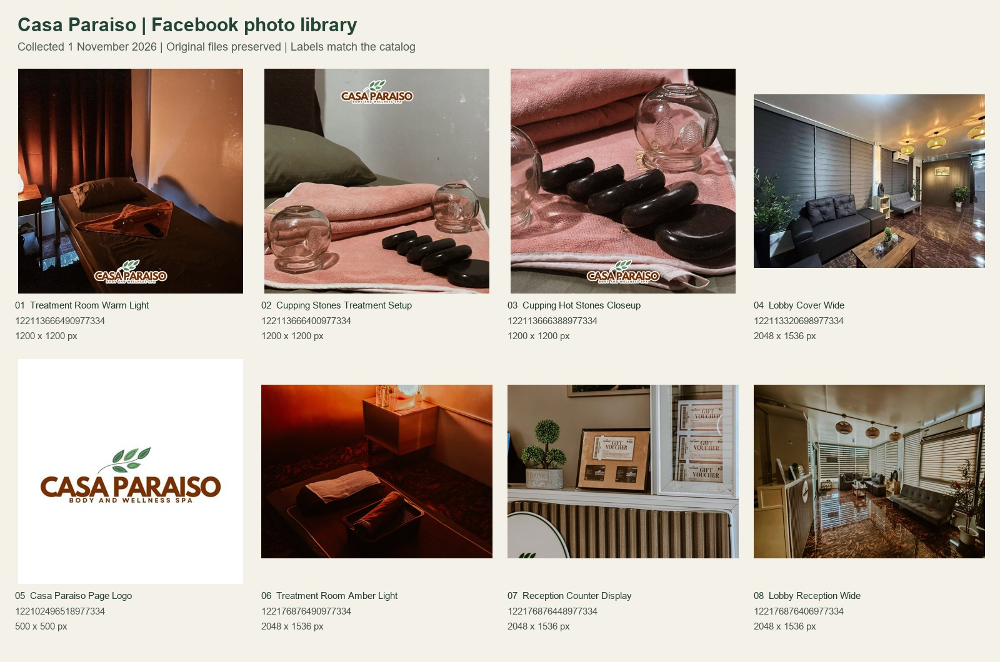

# Casa Paraiso Facebook Photo Library

Eight selected images collected on 1 November 2026 from the client's [Facebook page](https://www.facebook.com/profile.php?id=61579320037378). Files live in [assets/client/facebook/](../../assets/client/facebook/), outside the website's public directory. Website images, the existing logo, and database records are unchanged.

## Visual Index

Numbers below match the labels on the contact sheet. Open the linked JPEGs for the full downloaded image.

## Catalog

| No. | Local file | Dimensions (pixels) | Category | Source | Suggested use |
| --- | --- | --- | --- | --- | --- |
| 01 | [Treatment room, warm light](../../assets/client/facebook/treatment-room-warm-light-122113666490977334.jpg) | 1200 × 1200 | Interior | [Photo 122113666490977334](https://www.facebook.com/photo/?fbid=122113666490977334) | Secondary room detail; darker exposure, so avoid text over the photo. |
| 02 | [Cupping and stones, treatment setup](../../assets/client/facebook/cupping-stones-treatment-setup-122113666400977334.jpg) | 1200 × 1200 | Equipment / treatment detail | [Photo 122113666400977334](https://www.facebook.com/photo/?fbid=122113666400977334) | Actual spa equipment reference for ventosa and hot-stone treatment imagery. |
| 03 | [Cupping and hot stones, close-up](../../assets/client/facebook/cupping-hot-stones-closeup-122113666388977334.jpg) | 1200 × 1200 | Equipment / treatment detail | [Photo 122113666388977334](https://www.facebook.com/photo/?fbid=122113666388977334) | Close-up thumbnail or supporting treatment illustration; preserve embedded logo. |
| 04 | [Lobby cover, wide](../../assets/client/facebook/lobby-cover-wide-122113320698977334.jpg) | 2048 × 1536 | Interior | [Photo 122113320698977334](https://www.facebook.com/photo/?fbid=122113320698977334) | Lobby/arrival overview; compare with existing site imagery before future use. |
| 05 | [Casa Paraiso page logo](../../assets/client/facebook/casa-paraiso-page-logo-122102496518977334.jpg) | 500 × 500 | Branding | [Photo 122102496518977334](https://www.facebook.com/photo/?fbid=122102496518977334) | Brand reference only; retain the project's existing original logo. |
| 06 | [Treatment room, amber light](../../assets/client/facebook/treatment-room-amber-light-122176876490977334.jpg) | 2048 × 1536 | Interior | [Photo 122176876490977334](https://www.facebook.com/photo/?fbid=122176876490977334) | Wider room/equipment view; original warm lighting retained. |
| 07 | [Reception counter display](../../assets/client/facebook/reception-counter-display-122176876448977334.jpg) | 2048 × 1536 | Reception / branding | [Photo 122176876448977334](https://www.facebook.com/photo/?fbid=122176876448977334) | Reception or voucher display reference; printed prices are historical, not current product data. |
| 08 | [Lobby and reception, wide](../../assets/client/facebook/lobby-reception-wide-122176876406977334.jpg) | 2048 × 1536 | Interior | [Photo 122176876406977334](https://www.facebook.com/photo/?fbid=122176876406977334) | Arrival/contact section reference showing reception and seating together. |

## Selection and Access Limits

- Reviewed the page's Photos section and its Cover photos (3 items) and Profile pictures (2 items) albums through the browser. Selected actual rooms, equipment, reception, and the business logo. The library is curated, not a complete Facebook archive.
- Excluded customer snapshots, event/group portraits, announcements, dated promotions, hiring notices, the initial-letter profile placeholder, and repeated cover views. No suitable exterior/signage-only photo was selected.
- Downloaded the full photo-viewer renditions rather than gallery thumbnails, retaining the largest rendition exposed there for each selection. Facebook supplied 1200 × 1200, 2048 × 1536, and 500 × 500 images; camera originals or higher resolutions were not established. Facebook may require a signed-in session for later source access.
- Downloaded JPEGs retain their original bytes, colors, and embedded branding. The contact sheet alone contains resized previews and added labels. No generated imagery or retouching was used.
- Two room angles, two lobby angles, and setup/close-up equipment views are intentionally retained as different compositions. SHA-256 checks found no identical files; the contact sheet was visually reviewed for repeated compositions.
- The [manifest](../../assets/client/facebook/manifest.json) records each photo ID, source permalink, filename, dimensions, byte size, and SHA-256 hash. Temporary CDN URLs and browser-session information are not included.

See the separate [Facebook Page Review](FACEBOOK_PAGE_REVIEW.md) for business information and scope questions.
